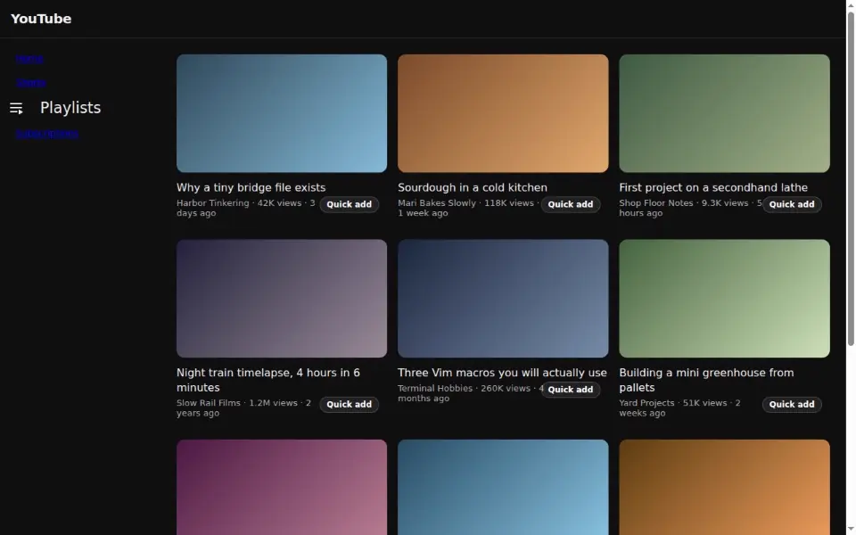

# Better Youtube (Chrome/Brave extension)

Add any YouTube video to your favorite playlists in one click, straight from Home or Subscriptions, and undo it right away if you change your mind.

The buttons appear on:
- **Quick add** on Home (`/`) and Subscriptions (`/feed/subscriptions`)
- **Remove** on playlist pages (`/playlist?list=...`) for each video row

Clicking Quick add opens your configured favorite playlists in your manual order from options. Clicking a playlist immediately adds that video to the real YouTube playlist, then the button turns into **Undo** (until reload) so you can revert quickly.

The sidebar also gets a **Playlists** entry under Shorts. It opens the same favorites, and one click goes straight to that playlist's page.

On playlist pages, each row gets a **Remove** button. Remove is immediate, then turns into **Undo** (until reload) to restore the video to that playlist.

## Try the demo

`npm run demo` opens Chromium with the extension loaded, a synthetic YouTube home page and three sample playlists. Try Quick add on a video, then open **Playlists** in the sidebar and pick one. No YouTube account is needed, and nothing reaches YouTube. It needs a Chromium build that still accepts `--load-extension`, since Google Chrome stable no longer does. Set `CHROME_BIN` to pick one.

## Install (unpacked)

1. Open `chrome://extensions` (or `brave://extensions`).
2. Enable **Developer mode**.
3. Click **Load unpacked**.
4. Select this folder.

## Configure playlists

1. Open the extension details page.
2. Click **Extension options**.
3. Paste playlist URL or playlist ID.
4. Optionally set a custom label, mark one as pinned (★ badge), and reorder with ↑/↓.

## Notes

- This extension stores only your selected favorites in `chrome.storage.sync`.
- It does **not** create extension-only playlists.
- It calls YouTube internal endpoints from the page context; if YouTube changes internals, updates may be needed.
